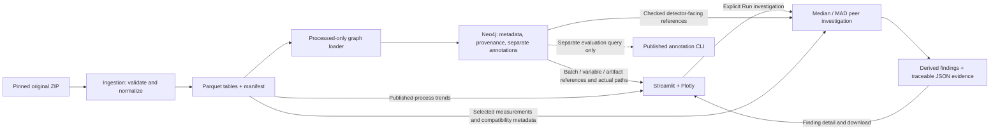

# Architecture and trade-offs

PharmaGraph is a local evidence-navigation MVP over published IndPenSim simulations. It combines deterministic normalization, a small provenance graph, an elapsed-time peer detector and a Streamlit UI. It does not model a real plant or make regulated process decisions.

For every technical component, exact data shapes, the graph model and the Run-investigation sequence, see [the complete architecture diagrams](architecture_detailed.md).

## Implemented data and execution paths

The archive is read only by ingestion/inspection. Runtime graph loading, investigations and UI views use existing processed files. The annotation query has no edge into the detector/UI path. There are no graph writes from investigation or presentation; findings remain derived JSON.

## Responsibilities and consistency

| Component | Actual role |
| --- | --- |
| `scripts/ingest_indpensim.py` | Verify pinned source bytes/structure, normalize selected fields, write three typed Parquet tables and a manifest; reuse only an intact cache |
| `scripts/graph.py`, loader/query CLIs | Validate the processed generation; create stable-ID nodes/structural edges; resolve batch/variable metadata and artifact/source references |
| `scripts/investigation.py` | Select compatible peers without target/labels; compare values at matching ticks; retain/rank persistent statistical deviations with supporting measurements |
| `scripts/demo.py`, `app.py` | Check current identities/live graph, cache reusable resources/data, render trends and findings, query actual provenance edges, serialize the unchanged result for download |

The three tables are `batches`, `samples` and `variables`. The original release contains 100 batches, 113,935 samples and 33 variable definitions. Full sample rows remain in Parquet. Every graph reference binds dataset/model version, exact manifest/cache key, stable batch/variable IDs, artifact filename/hash and source metadata. A measurement adds its sample ID, one-based CSV data-record number and zero-based source column.

Different graph/artifact generations fail explicitly. Same-generation loads use uniqueness constraints, parameterized batched writes and stable-ID `MERGE`; incomplete datasets are hidden from input queries until the loader marks them complete. Explicit `--replace` is scoped to one logical dataset. Manifest-last file publication is a completeness check, not an atomic directory transaction. Replacement assumes one loader; cross-store changes are not one database transaction.

The UI rehashes content/current contract and checks live graph pins before cached display. It caches the official driver privately, validated data by generation, and investigations by generation/batch/detector configuration/connection identity. Explicit Run controls full investigation execution; finding inspection reuses the existing pure scorer for plotting context.

## Why Neo4j and Parquet

Neo4j holds the small relationship-rich layer: batch membership, variable definitions, source files and versioned processed artifacts. The UI can show an actual connected path from a Batch to its ProcessedArtifact, the Variable linked to that artifact, and the SourceFile behind both. These are provenance and navigation relationships; the graph does not provide numerical anomaly scores or causal explanations.

Parquet holds wide numerical trajectories because the workload reads selected columns and aligns many observations by integer tick. Projecting 113,935 sample nodes or one node per measurement would add graph storage and loading work without helping this MVP's numerical method. The implemented graph has only **239 nodes and 708 relationships**.

A relational implementation could represent the same datasets, batches, variables, artifacts, annotations and source coordinates using tables, uniqueness/foreign-key constraints and SQL joins. It could support every current fixed query and the same detector. Neo4j is not necessary for detection accuracy, and this project makes no performance superiority claim. Its portfolio purpose is to demonstrate explicit relationship navigation and provenance checks. The trade-off is operating two stores and maintaining exact-generation consistency; a SQL-plus-Parquet variant would be simpler operationally for these fixed joins.

## Ontology-inspired, without formal ontology claims

The model gives explicit names and identities to six kinds of records: `Dataset`, `SourceFile`, `ProcessedArtifact`, `Batch`, `Variable` and `FaultAnnotation`. Eight directed relationship types describe membership and provenance: `HAS_SOURCE`, `HAS_ARTIFACT`, `HAS_BATCH`, `HAS_VARIABLE`, `FROM_SOURCE`, `HAS_DATA`, `DERIVED_FROM`, `HAS_ANNOTATION`.

This is ontology-inspired in its vocabulary and distinction between kinds of evidence. It is a property-graph schema, without an implemented RDF/OWL ontology, formal reasoning, entailment or standards conformance. `record_kind` distinguishes published simulation records/definitions/annotations from derived artifacts; findings have their own derived JSON kind. Count/time summaries are normalization-derived metadata. Structural edges do not represent equipment connectivity or cause and effect. Equipment, materials, quality specifications, fault types and other absent records are not invented.

## Detector assumptions and boundaries

The four channels are aeration, sugar feed, pH and temperature. Peers share the documented control regime, exclude the target, and contribute only finite values at exactly matching elapsed-time ticks. At least 10 peers are required; score is absolute difference from the peer median divided by 1.4826 × raw MAD. A strict score above 6 must persist for five same-direction consecutive observations. Intervals rank by mean point score.

Labels, raw flags and harvest values are not scoring inputs; published graph annotations are queried separately for evaluation. Their mutation/removal was tested to leave results unchanged. Existing full-bundle integrity checks are separate from feature selection. Batches 091–100 lack documented compatibility and are explicitly unassessed.

Important limits are simulated rather than GMP source data; coarse compatibility; elapsed-time rather than phase alignment; reference contamination; small/zero MAD; finite-peer loss late in a batch; only four assessed channels; and unresolved source units/Raman/operational metadata outside the selected subset. Scores are uncalibrated descriptive statistics, not probabilities, root causes or quality failures. A no-interval result is not a normal/safe decision.

The local demo has no authentication, multi-user deployment, production validation or backup workflow. Browser rendering/download verification and Docker container persistence remain manual verification gaps; real standalone Neo4j, engine behavior, Streamlit AppTest and HTTP checks are recorded separately. See [portfolio validation](portfolio_validation.md) and the [three-minute walkthrough](demo_walkthrough.md).

## Future improvements — outside frozen MVP scope

1. Add verified recipe/phase metadata before refining cohort compatibility or alignment; do not infer it from labels.
2. Define a held-out evaluation protocol and calibrate the existing heuristic separately from label-isolated detector inputs before claiming accuracy.
3. Automate clean-environment setup plus browser/download and Docker persistence checks to close reproducibility gaps.
