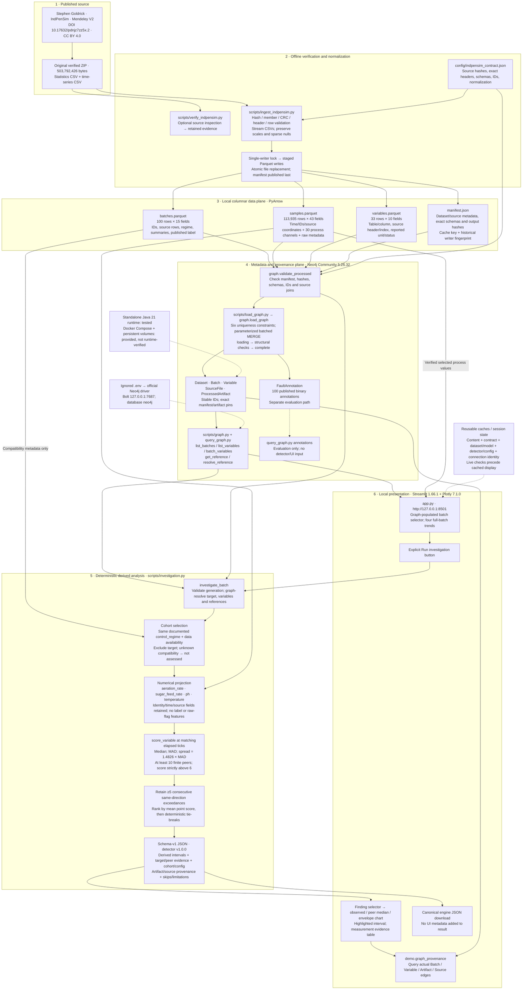
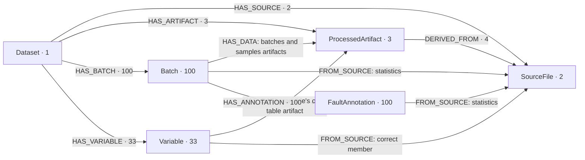

# PharmaGraph: complete technical architecture

Read the diagrams top to bottom: **published source → verified local tables → graph references → deterministic investigation → evidence UI/JSON**. The application has two data stores with different jobs. Neo4j answers what a batch/variable/artifact/source is and how they connect. Parquet supplies the measurements used in numerical analysis.

This describes implemented components only. The [compact architecture and trade-offs](architecture.md), [setup](../README.md), and [three-minute demo](demo_walkthrough.md) provide shorter entry points.

## 1. Complete component and data-flow diagram



**Boundary to notice:** published annotations exist for separate evaluation, but no annotation edge feeds cohort selection, scoring or the investigation UI. Existing integrity validation checks the complete processed bundle; feature selection and scoring still project only the approved numerical fields. No full time series or derived investigation nodes are added to Neo4j.

## 2. What the data actually looks like

### Original archive

| Member | Actual structure | Interpretation boundary |
| --- | --- | --- |
| Statistics CSV | 100 data rows, 5 fields: batch reference, 3 harvest summaries, published binary label | Harvest scale/aggregation are unresolved; the label does not name a fault or quality outcome |
| Time-series CSV | 113,935 data rows; 2,239 header fields but 2,237 values per row | Malformed/misleading metadata headers are retained as documented uncertainties |

Raw position 0 is elapsed hours; positions 1–30 are the selected process channels. The publisher-documented batch key is position 35 despite its misleading header. Raw metadata at positions 31–34 and 36 stays separate. Positions 37 onward are excluded from normalization; no corrected Raman axis is invented. One tick is exactly **0.2 h / 12 minutes**. Time resets for each batch; there is no absolute manufacturing calendar.

### Processed schemas

| Table | Fields and roles |
| --- | --- |
| `batches` · 15 fields | `dataset_id`, `batch_id`, `batch_ref`; statistics `source_file_id`/`source_row_number`; `fault_present`; `control_regime`; 3 `_raw` harvest fields; `sample_count`; `time_start_h`/`time_end_h`; first/last time-series source rows |
| `samples` · 43 fields | 8 identity/time/source fields; 5 explicitly raw metadata/flag fields; 30 wide float64 process fields |
| `variables` · 10 fields | `dataset_id`, `variable_id`, `output_table`, `output_column`, `source_file_id`, `source_column_index`, `source_header`, `unit_reported`, `unit_status`, `measurement_kind` |

The exact ordered types/nullability are in [the machine-readable contract](../config/indpensim_contract.json). Only the five designated sparse offline fields may contain normalized nulls; the MVP's four continuous channels do not use them. Source values are not converted or imputed.

Example real sample projection used by the detector/UI:

```json
{
  "sample_id": "indpensim:pdnjz7zz5x:v2:batch:031:tick:000430",
  "batch_id": "indpensim:pdnjz7zz5x:v2:batch:031",
  "time_tick": 430,
  "time_h": 86.0,
  "temperature": 298.38,
  "source_file_id": "indpensim:pdnjz7zz5x:v2:timeseries",
  "source_row_number": 34755
}
```

This is a projection, not the full 43-field stored row. The variable definition supplies zero-based column **17**, header **`Temperature(T:K)`**, unit **K**. Source rows are one-based data-record numbers **excluding the header**.

### Stable identity and reproducibility

- Dataset: `indpensim:pdnjz7zz5x:v2`.
- Batch: `{dataset_id}:batch:{batch_ref:03d}`.
- Sample: `{batch_id}:tick:{time_tick:06d}`.
- Variable: `{dataset_id}:variable:{output_column}`.
- Processed artifact: dataset + fixed filename + exact SHA-256.
- Manifest pins source archive bytes, output hashes/bytes/schemas, contract hash and historical normalization/writer fingerprint. Findings pin detector version and effective configuration as well.

The cache key identifies a normalization generation, not a new scientific dataset. A different graph/manifest/artifact generation fails instead of being silently mixed.

## 3. The implemented graph model



There are **239 nodes**, **708 relationships**, and six ID uniqueness constraints. `FROM_SOURCE` totals 233 edges and `HAS_DATA` totals 233. No `Sample`, equipment, material lot, quality specification or inferred fault-type nodes exist.

A Batch carries identity/provenance and derived count/time bounds; it does not carry the published fault flag or harvest values. The annotation has its own record kind and source coordinates. `record_kind` distinguishes published records/definitions/annotations from derived artifacts; JSON findings are separately marked `derived_statistical_deviation`.

The model is **ontology-inspired vocabulary**, not a formal RDF/OWL ontology, causal graph or reasoning system. The graph's actual role is explicit navigation and reference consistency. A relational schema with foreign keys and joins could perform all current fixed queries; Neo4j adds relationship-oriented presentation and a second-store operational/consistency cost, not demonstrated detection accuracy or speed.

## 4. What happens when Run investigation is pressed

```mermaid
sequenceDiagram
    actor Reviewer
    participant UI as app.py / scripts.demo
    participant G as Neo4j / scripts.graph
    participant P as Parquet + manifest
    participant E as scripts.investigation
    Reviewer->>UI: Select Batch 031
    UI->>P: Hash current manifest, outputs and contract
    UI->>G: Check live pins; list batches; resolve four references
    P-->>UI: Verified process values
    UI-->>Reviewer: Four published simulation trends
    Reviewer->>UI: Run investigation
    UI->>E: investigate_batch with unchanged defaults
    E->>G: Resolve target, available variables and peer references
    E->>P: Read compatibility and approved process projections
    E->>E: Exclude target; align exact ticks; median / MAD
    E->>E: Coverage / zero-MAD rules; persistent runs; rank
    E-->>UI: Derived JSON with full evidence and limitations
    Reviewer->>UI: Select finding
    UI->>E: Reuse score_variable for cached plotting context
    UI->>G: Read actual provenance relationship path
    UI-->>Reviewer: Trend, envelope, evidence and provenance
    Reviewer->>UI: Download JSON
    UI-->>Reviewer: Canonical engine result bytes
    Note over UI,E: Finding selection / rerenders do not rerun full investigation
```

The scorer is transparent:

```text
For each variable and exact target tick:
  finite values from compatible peers, excluding target
  require at least 10 finite peers
  m = median(peer values)
  MAD = median(abs(peer values - m))
  spread = 1.4826 * MAD
  score = abs(target value - m) / spread

Retain scores strictly > 6 for at least 5 consecutive ticks,
all above or all below their respective peer medians.
Rank intervals by mean point score; report peak score separately.
```

Missing/nonfinite target values, unmatched ticks and insufficient coverage break runs. A zero-MAD reference gives score 0 if the target equals the median; otherwise the comparison is explicitly unscoreable. There is no epsilon, fill, extrapolation or interpolation. Five consecutive observations span 0.8 h between endpoints. The score and envelope are not probabilities, confidence intervals, operating specifications or product-quality rules.

The cohort uses documented control regimes: recipe-driven 001–030, operator-controlled 031–060, APC/Raman 061–090. Membership may be restricted through the CLI but cannot override compatibility or include the target. Batches 091–100 are **not assessed** because their process compatibility is undocumented. The label is not consulted to make that choice.

## 5. Technical components and responsibilities

| Component | Main interfaces / behavior |
| --- | --- |
| Source contract | `config/indpensim_contract.json`: pinned archive, exact source headers, field definitions, types/nullability, stable-ID rules |
| Source inspection | `scripts/verify_indpensim.py`: read-only ZIP inspection; retained provenance/uncertainty evidence |
| Ingestion | `ingest`, `_validate_archive`, `_normalize`, `_cache_miss`, staged writers; original-source checks even for cache reuse |
| Graph core | `validate_processed`, `load_graph`, `graph_counts`, `check_graph_integrity`; parameterized Cypher and exact-generation guards |
| Detector-facing graph reads | `list_batches`, `list_variables`, `batch_variables`, `get_reference`, `resolve_reference`; explicit fields rather than annotation/property dumps |
| Separate evaluation read | `published_annotations`; available through CLI, absent from investigation/UI calls |
| Detector configuration | Frozen `DetectorConfig`: four-channel allowlist; min peers 10, threshold 6.0, min consecutive 5; detector v1.0.0 |
| Engine | `investigate_batch`: graph-reference validation, compatibility, numerical projection, final identity/hash checks |
| Pure numerical method | `score_variable`: per-tick median/MAD, diagnostic statuses, intervals and deterministic ranks |
| Investigation CLI | `scripts/investigate_batch.py`: JSON errors, protected output paths, atomic sorted-key UTF-8 JSON publication |
| Demo adapter | `scripts/demo.py`: content/connection identities, live checks, trends, reuse of scorer for plots, evidence rows, actual graph path query, sanitized errors |
| Streamlit entry point | `app.py`: select → trends → explicit Run → finding → evidence/provenance/download; distinct findings/no-retained/unassessed states |
| Data/resource caches | Streamlit resource cache for official driver; generation-keyed bundle/trend caches; session result/plot context caches; live checks outside cache |
| Local configuration | Ignored `.env` with server-only `NEO4J_*`; `.streamlit/config.toml` uses loopback, light theme, disabled usage statistics and hidden raw errors |
| Runtime/dependencies | Python 3.11, PyArrow21.0.0, Neo4j driver5.28.2, Neo4j Community5.26.32 / Java21, Streamlit1.66.1, Plotly7.1.0 |
| Runtime alternatives | Tested standalone Neo4j; provided Docker Compose with healthcheck/named volumes, not runtime-verified |
| Quality checks | Unit/synthetic fixtures, real Neo4j tests, real-data AppTest, deterministic JSON/source traces, HTTP health; browser/container gaps are recorded |

## 6. What the project can actually achieve

| Capability | Demonstrated evidence |
| --- | --- |
| Validate source and reusable normalized data | Original pinned ZIP inspection; deterministic ingestion/cache/rebuild evidence |
| Navigate a versioned batch/variable/artifact/source chain | Real Neo4j query paths and source trace; idempotent 239-node/708-edge loads |
| Find persistent deviations from documented compatible peers | Batch031 temperature above peers at 86–87h; 6 observations; mean score11.8036 |
| Explain a reported point numerically | At86h: observed298.38K, median297.99K, MAD≈0.02K, spread0.029652K, point score13.1526, 29 finite peers |
| Trace evidence to its original location | Time-series source member, row34755, column17; stable sample ID and artifact/archive checksum pins |
| Represent a meaningful empty result | Batch001 assessed but no retained intervals; not classified normal/safe |
| Refuse unsupported comparison | Batch091 explicitly not assessed, rather than silently pooled with known regimes |
| Keep labels outside scoring | Real fixture annotation mutation/removal leaves complete engine results unchanged |
| Support a local reviewer flow | Streamlit AppTest on real data; exact engine JSON download payload; actionable failure states |

This does not establish detection accuracy, fault diagnosis, root cause, causal effects, quality release, clinical severity, regulatory compliance or production readiness. Coarse cohorts, phase mismatch, small/zero MAD, limited channels and uncertain source semantics remain important limitations.

## 7. Verification boundary

Historical checks include a real standalone Neo4j restart, real-data investigations, deterministic output, source tracing, Streamlit AppTest and HTTP checks. AppTest is **not** a browser screenshot or visual interaction test. Chrome computer-use access was denied; browser layout/hover/zoom/file saving and screenshots remain unverified. Docker container startup/healthcheck/named-volume/restart behavior remains outstanding. Final test/hygiene results are in [portfolio_validation.md](portfolio_validation.md).

The full original ZIP, processed numerical cache, runtime binaries, credentials and local database stay outside Git. Retained examples and metadata are documented in [the evidence inventory](evidence/README.md). No external publication, remote push, history rewrite or feature expansion was performed during portfolio finalization.
