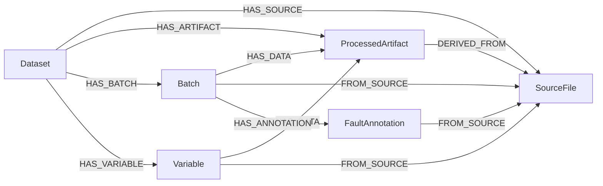

# Minimal Neo4j investigation graph

Model version **1** follows direct inspection of the three processed Parquet schemas. It supersedes the milestone-2 sample-node proposal. The interfaces and ownership are fixed in [graph_contract.md](graph_contract.md); execution evidence and limits are in [graph_validation.md](graph_validation.md).

## Projection from the actual tables

`batches.parquet` has 100 rows, `samples.parquet` 113,935 rows, and `variables.parquet` 33 rows (30 process variables and 3 raw harvest summaries). The exact field order, Arrow types and nullability match [the ingestion contract](../config/indpensim_contract.json). Ingestion is unchanged.

All time-series values stay in Parquet. `Sample` and per-cell measurement nodes are unnecessary for navigating a batch, variable, processed artifact and original source coordinates. The graph stores only these six labels:

| Label | Identity | Role / properties |
| --- | --- | --- |
| `Dataset` | Manifest `dataset.id` | Published simulation dataset metadata; exact manifest SHA-256, cache key, model version and loading/completeness state |
| `SourceFile` | Manifest member `source_file_id` | Published CSV provenance: archive hash/name, member path, byte count, CRC and data-row count |
| `ProcessedArtifact` | `{dataset_id}:artifact:{filename}:sha256:{sha256}` | Derived Parquet artifact: fixed relative filename, hash, byte/row count and table name; no absolute client paths |
| `Batch` | Existing `{dataset_id}:batch:{batch_ref:03d}` | Published batch identity and statistics-row provenance; normalization-derived sample count, observed time bounds and source-row bounds |
| `Variable` | Existing `{dataset_id}:variable:{output_column}` | Published variable definition: table/column, source file/header/column index, reported unit and uncertainty |
| `FaultAnnotation` | `{batch_id}:annotation:published_fault_present` | Published binary statistics annotation and its own statistics-row/column provenance, separate from batch/process data |

Each label has a uniqueness constraint on its identity property. Every node carries `dataset_id`. Original-release node counts: **1 + 2 + 3 + 100 + 33 + 100 = 239**. All 100 binary annotations are retained, including false values; 10 are true. Batch count/time/source-row summaries are normalization-derived metadata, not new experimental observations. `record_kind` distinguishes published records/definitions/annotations from derived artifacts. No detector-derived evidence is created in this milestone.

## Relationships

| Type | From → To | Expected original-release count |
| --- | --- | ---: |
| `HAS_SOURCE` | Dataset → SourceFile | 2 |
| `HAS_ARTIFACT` | Dataset → ProcessedArtifact | 3 |
| `HAS_BATCH` | Dataset → Batch | 100 |
| `HAS_VARIABLE` | Dataset → Variable | 33 |
| `FROM_SOURCE` | Batch/Variable/FaultAnnotation → corresponding SourceFile | 233 |
| `HAS_DATA` | Batch → batches/samples artifacts; Variable → its own table artifact | 233 |
| `DERIVED_FROM` | ProcessedArtifact → source member(s) | 4 |
| `HAS_ANNOTATION` | Batch → FaultAnnotation | 100 |

Total: **708** relationships. These edges express record membership and provenance, not causality or physical connectivity.



## Detector inputs and evidence resolution

Detector-facing queries return explicit fields. Batch nodes and their query responses exclude fault labels, control campaign/regime, raw metadata flags and harvest values. Variable inventories default to the 30 samples-table process variables. The three raw harvest summaries require `--include-summaries`. Fault annotations are retrieved through a separate evaluation query.

A batch/variable reference binds `dataset_id`, exact manifest hash/cache key, batch identity, variable definition, artifact identity/filename/hash and original source metadata. The shared `HAS_DATA` artifact identifies whether the measurement is a time series or a batch summary. Variable provenance must agree with that artifact's source.

A time-series reference has no single source row. Resolution filters verified `samples.parquet` by `batch_id` and the allowlisted variable's `output_column`; each returned measurement supplies its actual one-based CSV data-record number. A summary resolves from `batches.parquet` using the batch's statistics row. Source-column indices are zero-based. No absolute stored file path or user-provided property name is interpolated into Cypher or trusted for local reads.

For example, bind `$dataset_id = 'indpensim:pdnjz7zz5x:v2'`, `$batch_ref = 91`, and `$variable_name = 'ph'` to this parameterized structural lookup (the Python APIs return additional pinning metadata):

```cypher
MATCH (d:Dataset {dataset_id: $dataset_id, load_state: 'complete', graph_model_version: 1})
      -[:HAS_BATCH]->(b:Batch {batch_ref: $batch_ref})
MATCH (d)-[:HAS_VARIABLE]->(v:Variable)-[:HAS_DATA]->(a:ProcessedArtifact)<-[:HAS_DATA]-(b)
MATCH (v)-[:FROM_SOURCE]->(s:SourceFile)<-[:DERIVED_FROM]-(a)
WHERE v.output_table = 'samples' AND a.output_table = v.output_table
  AND v.output_column = $variable_name AND v.source_file_id = s.source_file_id
RETURN b.batch_id, v.variable_id, v.output_column, v.source_column_index,
       v.source_header, v.unit_reported, v.unit_status,
       a.artifact_id, a.filename, a.sha256, s.source_member_path,
       s.archive_sha256, d.manifest_sha256, d.cache_key
```

Evaluation uses a separate path:

```cypher
MATCH (d:Dataset {dataset_id: $dataset_id, load_state: 'complete', graph_model_version: 1})
      -[:HAS_BATCH]->(b:Batch {batch_ref: $batch_ref})
      -[:HAS_ANNOTATION]->(a:FaultAnnotation)-[:FROM_SOURCE]->(s:SourceFile)
RETURN b.batch_id, a.fault_present, a.annotation_kind, a.source_header,
       a.source_column_index, a.source_row_number, s.source_member_path
```

## Dataset lifecycle

Before loading or resolving, validate the complete manifest, output hashes/bytes, exact schemas, row counts, stable identities and source joins against the pinned ingestion contract. Historical normalizer/Python/PyArrow fingerprints are provenance; they need not equal the current installed writer. The loader never opens, decompresses or parses the original archive.

The Dataset pins one exact manifest and model version. Incompatible loads fail before changing dataset graph data. Re-running an intact same-manifest load uses stable-ID `MERGE` and completes interrupted loads without adding duplicates. A partially loaded dataset is marked `loading`; query APIs reject it. The manifest guard uses a Dataset write lock, following [Neo4j's documented locking mechanism](https://neo4j.com/docs/operations-manual/current/database-internals/concurrent-data-access/). Batched writes use [managed transactions and consumed results](https://neo4j.com/docs/python-manual/current/transactions/).

A processed rebuild requires an explicit `--replace` to replace only the same logical dataset's nodes. A genuinely different published release needs a new dataset ID and contract. Use one loader at a time during replacement; stop concurrent readers while changing local processed files. Do not use replacement to relabel incompatible source releases as the same dataset. The exact manifest-byte hash means even reformatting a manifest requires explicit replacement.

## Scientific boundaries

No equipment, maintenance, materials, operators, specifications, quality outcomes, named fault types, causal links, or inferred fault-window events are introduced. Raw flag transitions do not establish physical onset or a fault diagnosis. Source units and harvest aggregation remain uncertain as documented in [data_dictionary.md](data_dictionary.md); values retain source scales, and sparse nulls remain null. Offline assays have no invented result-availability timestamp. Raman data remain excluded because their mapping is unresolved. A false published batch annotation is not an approved operating specification.
